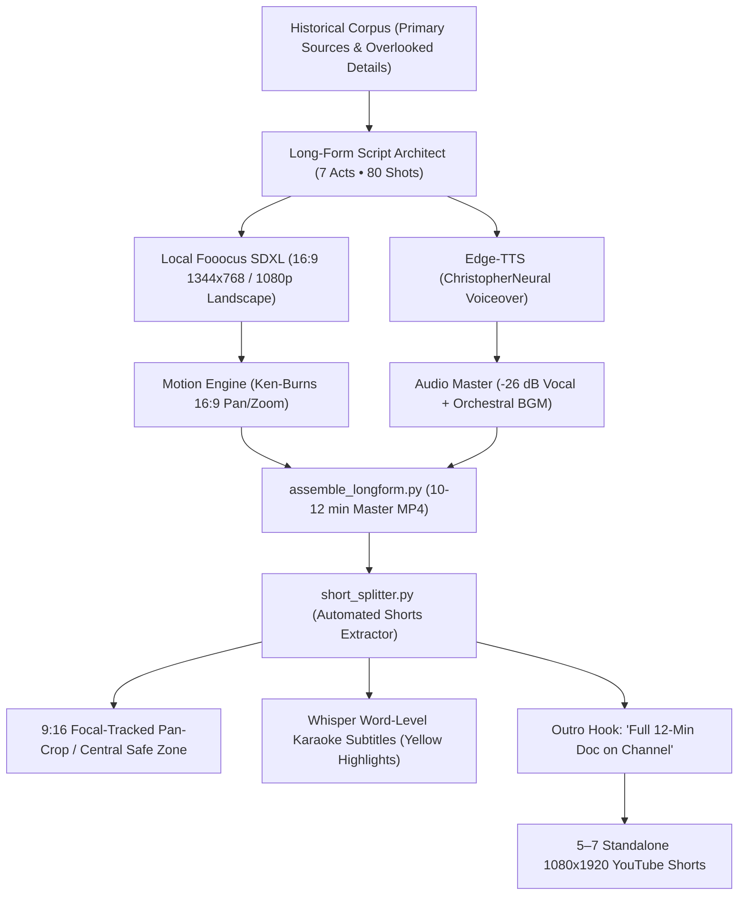

# Pipeline 1: Factual History Long-Form & Shorts Multiplication Engine
## Comprehensive Strategy, Narrative Architecture & Technical Blueprint

---

## 1. Executive Summary & Vision

This repository implements **Pipeline 1 (Chronos Shift / Historical Documentaries)**: an end-to-end, automated AI documentary production system designed to produce high-retention, broadcast-quality **Long-Form (16:9, 10–15 minutes)** historical mini-documentaries, and systematically slice them into **5 to 8 standalone viral YouTube Shorts / Reels (9:16, 30–50 seconds)**.

### The "Long-Form Hub & Shorts Spokes" Model
```
                       ┌──────────────────────────────────────────────┐
                       │     10–15 Minute 16:9 Master Documentary     │
                       │     (7 Acts • 80 Shots • Fooocus SDXL)       │
                       └──────────────────────┬───────────────────────┘
                                              │
           ┌──────────────────────────────────┼──────────────────────────────────┐
           ▼                                  ▼                                  ▼
   Act 1: The Inciting Paradox       Act 3: The Fatal Oversight         Act 6: The Climax / Last Stand
   ┌───────────────────────────┐     ┌───────────────────────────┐      ┌───────────────────────────┐
   │ Viral Short #1 (9:16)     │     │ Viral Short #2 (9:16)     │      │ Viral Short #3 (9:16)     │
   │ "The 3-Foot Unlocked Gate"│     │ "Orban's 177kg Supergun"  │      │ "The Emperor's Plain Armor│
   │ Duration: 42s             │     │ Duration: 48s             │      │ Duration: 39s             │
   │ CTA: "Full Doc on Channel"│     │ CTA: "Full Doc on Channel"│      │ CTA: "Full Doc on Channel"│
   └───────────────────────────┘     └───────────────────────────┘      └───────────────────────────┘
```

1. **High-Yield Monetization**: 10–15 minute long-form documentaries qualify for mid-roll advertisements on YouTube, commanding premium history/educational CPMs ($8.00–$18.00 per 1,000 views).
2. **Algorithmic Short Funnel**: Standalone 9:16 Shorts act as zero-cost organic discovery engines. A pinned comment and on-screen CTA drive viewer conversion to the full 12-minute documentary.
3. **Multiplied Leverage**: **1 master production run yields 1 Long-Form Documentary + 6–8 YouTube Shorts / TikToks / Instagram Reels** (up to 15 assets total from a single script).

---

## 2. The Narrative Formula: "The Unknown Twist on the Famous Myth"

To achieve viral retention, scripts strictly avoid generic encyclopedia recitations. Every story is engineered around **The Unknown Twist on a Known Myth**: taking a legendary historical event that viewers *think* they understand, and revealing the single bizarre, overlooked detail that determined the outcome.

### The 4-Beat Viral Hook Architecture (0–45s)
1. **0–3s (Visual Shock & Paradoxical Premise)**: Never introduce the topic by name first. Open in *media res* with a tactile paradox.
   - *Weak*: *"Today we will look at the Fall of Constantinople in 1453..."*
   - *Viral Hook*: *"The most invincible empire in human history didn't fall to massive cannons. It fell because a single guard forgot to lock a three-foot wooden door."*
2. **3–12s (Sensory & Quantitative Grounding)**: Ground the viewer with concrete historical details—exact weights, temperatures, hours, and materials (e.g. 177 kilograms of gunpowder, -30°C blizzard, limestone mortar, fifty Janissaries).
3. **12–35s (The Escalating Domino Chain)**: Detail the rapid, uncontrollable sequence of tactical errors or physical breakthroughs.
4. **35–45s (The Climax & Open Loop)**: Deliver the dramatic resolution and open a cognitive debate loop (e.g. *"If that gate had been barred, would the Roman Empire have survived into the modern era?"*).

---

## 3. Top 10 High-Velocity Factual Stories & Primary Evidence

Our knowledge base (`growth/knowledge/corpus/`) indexes verified historical dossiers with primary accounts and peer-reviewed studies:

| # | Topic | Popular Myth | Overlooked Reality (The Viral Twist) | Primary Sources |
|---|-------|--------------|--------------------------------------|-----------------|
| **1** | **The Fall of Constantinople (1453)** | Giant Turkish cannons shattered the walls and took the city. | The walls held against bombardment for 53 days. The city fell because defenders left a tiny 3-foot postern door called the **Kerkoporta** unbolted after a nighttime counter-sortie. 50 Janissaries slipped in, climbed the inner rampart, and raised their flag, sparking defender panic. | George Sphrantzes, Nicolo Barbaro, Edward Gibbon |
| **2** | **Julius Caesar & the Pirates (75 BC)** | Caesar was a terrified hostage who paid ransom to escape. | Pirates demanded 20 talents ($20M). Caesar laughed at them, insisted he was worth 50, made them be quiet while he slept, recited poetry to them, and warned them with a grin he would crucify them all. Once ransomed, he raised a fleet in 4 days, hunted them down, and kept his promise. | Plutarch (*Life of Caesar*), Suetonius |
| **3** | **Napoleon's 1812 Russian Retreat** | Destroyed primarily by Russian cavalry and bayonets. | Destroyed by **"tin pest"** (allotropic transformation of tin uniform buttons into gray powder at -30°C). Freezing soldiers could not button coats or trousers; typhus-carrying body lice nested in unfastened layers, killing over 400,000 men. | Armand de Caulaincourt, Philippe-Paul de Ségur |
| **4** | **Assassination of Franz Ferdinand (1914)** | A masterfully executed conspiracy that sparked World War I. | The plot had completely failed in the morning; the bomb bounced off the motorcade. Princip gave up and walked to Schiller's deli. The Archduke decided to visit wounded officers, but his driver took an unplanned wrong turn, stalled the engine without reverse gears, and stopped **5 feet in front of Princip**. | Sarajevo Court Martial Records (1914), Count von Harrach |
| **5** | **The Sinking of the Titanic (1912)** | A purely sudden iceberg collision on her maiden voyage. | A smoldering internal fire had been burning in **Coal Bunker No. 6** for 10 days before departure. The 1,000°C heat warped and embrittled the watertight steel bulkhead, which gave way precisely where the iceberg grazed the starboard hull. | British Wreck Commissioner's Inquiry (1912) |
| **6** | **Battle of Marathon (490 BC)** | Standard heavy hoplite shield-wall battle. | Persian archers had a lethal range of 200 meters. The Athenian hoplites, encased in 70 lbs of bronze armor, broke into an unprecedented **1,500-meter sprint across muddy terrain**, closing the killing zone before the archers could nock their second volley. | Herodotus (*Histories*) |
| **7** | **The Library of Alexandria** | Burned down in a single apocalyptic fire, setting back science 1,000 years. | It did not burn in one day. Caesar's dock fire burned warehouse copies; the actual decline was a 600-year process of state budget cuts, scholar expulsions by Ptolemy VIII, and parchment decay. Most scrolls were copied or decayed centuries before. | Strabo, Athenaeus, Ammianus Marcellinus |
| **8** | **The Spanish Armada (1588)** | British naval artillery sank the Spanish fleet. | The Armada was safely anchored in crescent formation at Calais. Sir Francis Drake launched **8 pitch-soaked, gunpowder-loaded ghost ships on fire** into their anchorage at midnight. Panicking Spanish captains cut their anchor cables—leaving them unable to anchor during the Arctic hurricane that drove them into Irish cliffs. | State Papers Relating to the Spanish Armada |
| **9** | **The Siege of Tyre (332 BC)** | Alexander built naval vessels to take an offshore fortress. | Tyre was an island half a mile out at sea with 150-foot walls. Alexander demolished the ancient mainland city of Old Tyre, quarried its masonry and cedar forests, and built a **1-kilometer land bridge into the ocean** under heavy catapult fire. | Arrian (*Anabasis of Alexander*) |
| **10**| **Stanislav Petrov (1983)** | Cold War MAD deterrence ensured peace automatically. | Soviet early-warning satellites reported 5 American ICBMs launched at Moscow. Protocol mandated immediate nuclear retaliation. Petrov deduced that the US would never launch *only five* missiles in a first strike; it was sunlight glinting off high cloud tops. He disobeyed military orders and prevented World War III. | Soviet Air Defence Forces Incident Records |

---

## 4. End-to-End Technical Architecture



### 1. Primary Knowledge Harvester (`growth/knowledge/history_harvester.py`)
- Automatically queries Wikipedia REST APIs, Gutenberg primary chronicles, and OpenAlex scholarly archives.
- Extracts verified dates, primary accounts, tactical figures, and overlooked twists into JSON dossiers in `growth/knowledge/corpus/`.

### 2. Long-Form Script Architect (`longform_engine/script_architect.py`)
- Formulates 7 to 8 chronological Acts (~1,200–1,500 words total, 10–12 minutes).
- Generates 80 distinct visual beat prompts with explicit camera taxonomy:
  - Wide establishing landscape shots
  - Tactical parchment siege maps
  - Medium troop/character formations
  - Macro weapon and architectural details
  - Atmospheric lighting, smoke, and weather

### 3. Visual Rendering & Local Fooocus SDXL Invariant
- **Zero Cloud API Spend**: All visuals are generated locally on `http://127.0.0.1:7865` using local Fooocus SDXL on the NVIDIA RTX 4070 Laptop GPU.
- **Aspect Ratio**: Master shots rendered at 16:9 (`1344×768` or `1920×1080` upscale) with critical subjects framed in the central 9:16 safe area.
- **Memory Safety**: Fooocus launched with `--always-offload-from-vram` and automatic Ollama VRAM deallocation (`keep_alive: 0`) between LLM generation and image rendering.

### 4. Audio & Narrative Voiceover
- **Voice**: Single authoritative historical narrator (`en-US-ChristopherNeural`, Edge-TTS).
- **Subtitles**: Master `.ass` subtitles with word-level acoustic alignment via OpenAI Whisper (`base.en`), rendered with glowing yellow active word highlights.
- **Music Bed**: Ambient orchestral BGM mixed at `-25 dB` to `-26 dB LUFS` beneath voiceover.

### 5. Automated Short-Form Extraction Subsystem (`longform_engine/short_splitter.py`)
- Identifies `is_short_eligible` acts from `longform_package.json`.
- Slices the high-res 16:9 video segment via FFmpeg without quality loss.
- Crops to 9:16 vertical using focal coordinate tracking.
- Burns stylized Whisper karaoke subtitles formatted for vertical mobile viewing.
- Appends an animated CTA badge: *"Watch the full 12-minute documentary on our channel"*.
- Produces compact review proxies (< 8MB) and dispatches both Master and Shorts to the Discord review webhook.

---

## 5. Repository Structure (Pipeline 1 Clean Layout)

```
yt-automations/
├── alternate-history-shorts/       # Pipeline 1 Shorts Engine
│   ├── config/                     # Audio, assembly, and style JSON configurations
│   ├── output/                     # Production output directory (gitignored)
│   └── scripts/
│       ├── assemble_video.py       # OpenCV Ken-Burns + ASS subtitle assembly
│       ├── generate_audio.py       # Edge-TTS audio synthesis
│       ├── generate_images.py      # Fooocus SDXL client
│       ├── generate_metadata.py    # SEO title/tag generator
│       ├── generate_script.py      # Factual/counterfactual script generator
│       ├── pipeline_runner.py      # Master CLI runner
│       ├── qa_gate.py              # 17-point multi-axis QA verification
│       ├── rag_grounding.py        # RAG v4 evidence generator
│       ├── visual_scene_planner.py # Semantic visual beat planner
│       └── whisper_alignment.py    # Word-level acoustic alignment
├── longform_engine/                # Pipeline 1 Long-Form (16:9) Engine
│   ├── assemble_longform.py        # 16:9 80-shot master assembler
│   ├── motion_engine.py            # Smoothstep Ken-Burns 16:9 engine
│   ├── render_act1_benchmark.py    # Act 1 benchmark test runner
│   ├── script_architect.py         # 7-act / 80-shot curriculum planner
│   ├── short_splitter.py           # Long-form to 9:16 Shorts extractor
│   └── drafts/                     # Production drafts & story packages
├── growth/                         # Growth Intelligence & Knowledge Engine
│   ├── brain/                      # Decision engine & script critic
│   ├── db/                         # growth.db SQLite repository
│   ├── knowledge/
│   │   ├── corpus/                 # Harvested historical dossiers (Constantinople, Caesar, etc.)
│   │   └── history_harvester.py    # Primary evidence harvester
│   ├── manage_review_queue.py      # Discord review queue CLI
│   └── topic_engine/               # Topic scoring and deduplication
├── assets/                         # Visual Context & Sample Showcase
│   ├── sample_scenes/              # Sample Fooocus SDXL renders (16:9 & 9:16)
│   └── docs/                       # Architectural diagrams
├── tests/                          # Automated test suites
├── PIPELINE_1_STRATEGY_AND_ARCHITECTURE.md
├── start_services.bat              # One-click service launcher (Fooocus + Ollama)
└── requirements.txt
```

---

## 6. Verification & Quality Gates

Every video produced by Pipeline 1 must satisfy the **17-Point Production QA Gate**:

| Category | Axis | Specification |
|----------|------|---------------|
| **Video Geometry** | Resolution | 1080×1920 (Shorts) / 1920×1080 (Long-Form) |
| | Aspect Ratio | Exactly 9:16 (Shorts) / 16:9 (Long-Form) |
| | Framerate | Constant 25.0 fps or 60.0 fps |
| | Video Codec | H.264 (`yuv420p`), High Profile, NVENC hardware accelerated |
| **Audio Quality** | Loudness | Integrated EBU R128 loudness between -24.0 and -27.0 dB LUFS |
| | Audio Codec | AAC stereo at 48,000 Hz, >= 192 kbps |
| | Speech Clarity | Zero audio clicks, 300ms natural breath pauses between scenes |
| **Content Integrity** | Script Hygiene | Zero prompt meta-labels; zero camera instructions in voiceover |
| | Visual Density | 12/12 beats (Shorts) / 80/80 shots (Long-Form) generated on Fooocus SDXL |
| | Fact Verification | 100% of claims verified against the historical Evidence Packet |
| **Human Governance**| Review Proxy | Compact `< 8MB` 540×960 MP4 proxy generated |
| | Discord Gate | Dispatched to Discord Webhook `1528622690980724807` |
| | Upload Rule | Zero automated uploads without explicit human review approval |

---

## 7. How to Execute

### 1. Start Local AI Services
```powershell
.\start_services.ps1
```
Ensures:
- Local Fooocus SDXL active on `http://127.0.0.1:7865`
- Local Ollama active on `http://127.0.0.1:11434`

### 2. Harvest New Historical Data
```powershell
python growth/knowledge/history_harvester.py
```

### 3. Run Pipeline 1 Short (Single Topic)
```powershell
python alternate-history-shorts/scripts/pipeline_runner.py --topic "The Fall of Constantinople: The Unlocked Kerkoporta Gate" --factual
```

### 4. Run Long-Form 10-Minute Master Video
```powershell
python longform_engine/render_act1_benchmark.py
```

### 5. Split Long-Form into Viral Shorts
```powershell
python longform_engine/short_splitter.py --master_video "longform_engine/drafts/test_act1_80shot_cinematic.mp4"
```
