# YouTube Automation Engine: Factual History Long-Form & Shorts Platform

A production-grade, closed-loop YouTube documentary and viral shorts generation, validation, review-gating, and empirical learning platform.

> [!NOTE]
> The `main` branch is dedicated exclusively to **Pipeline 1: Chronos Shift / Factual Historical Documentaries** (Long-Form 16:9 Master Documentaries + Multi-Shorts 9:16 Hub-and-Spoke Engine).
> The previous secondary pipeline (`convo-shorts` / Debate Protocol) and SaaS experiments (`repograder`) are preserved intact on the [`backup/pipeline-2`](https://github.com/sainishath/yt-automation/tree/backup/pipeline-2) branch.

---

## 📖 Primary Documentation & Blueprint
- **[Full Strategy & Architecture Specification](PIPELINE_1_STRATEGY_AND_ARCHITECTURE.md)**: Complete guide to the Long-Form Hub & Shorts Spoke model, 4-beat viral hook architecture, historical knowledge corpus, and technical pipeline.
- **[Visual Grounding Showcase](assets/README.md)**: Native 16:9 cinematic master frames and 9:16 vertical reel renders generated via local Fooocus SDXL.
- **[Historical Knowledge Corpus](growth/knowledge/corpus/)**: Factual dossiers with primary sources (Plutarch, Gibbon, British Board of Trade, etc.) and overlooked historical details.

---

## 🏛️ High-Level System Architecture

```mermaid
flowchart TD
    %% ==========================================
    %% LAYER 1: KNOWLEDGE & RESEARCH
    %% ==========================================
    subgraph RESEARCH["1. Factual History Grounding & Corpus"]
        CORPUS[("growth/knowledge/corpus/\nPrimary Evidence Dossiers\n(Constantinople, Caesar, Napoleon, Titanic)")]
        RAG["ScriptArchitect & RAG Grounding\n(Overlooked Detail + Sensory Anchors)"]
        CORPUS --> RAG
    end

    %% ==========================================
    %% LAYER 2: PRODUCTION ENGINE
    %% ==========================================
    subgraph PRODUCTION["2. Dual-Format Production Engine"]
        subgraph LONGFORM["Long-Form Engine (16:9 Widescreen)"]
            LF_SCRIPT["script_architect.py\n(7 Acts • 80 Shots • 10-15 Min)"]
            LF_IMAGE["Fooocus SDXL (Port 7865)\n(1344x768 Cinematic Master)"]
            LF_VOICE["Edge-TTS Narrator\n(en-US-ChristopherNeural)"]
            LF_COMP["assemble_longform.py\n(Lossless Concat + Chapter Marks)"]
            
            LF_SCRIPT --> LF_IMAGE --> LF_VOICE --> LF_COMP
        end

        subgraph SHORTS["Viral Shorts Engine (9:16 Vertical)"]
            SH_RUN["pipeline_runner.py / short_splitter.py\n(30-50s Standalone Spoke)"]
            SH_IMAGE["Fooocus SDXL (Port 7865)\n(896x1152 Vertical Composition)"]
            SH_KB["OpenCV Subpixel Ken Burns\n(Directional Focal Pan/Zoom)"]
            SH_SUB["Whisper Karaoke ASS Subtitles\n(Word-by-word Highlight)"]
            SH_QA["17/17 QA Gate\n(Zero Black Frames / Audio Sync)"]
            
            SH_RUN --> SH_IMAGE --> SH_KB --> SH_SUB --> SH_QA
        end

        RAG --> LF_SCRIPT
        LF_COMP -.->|"Automated Act Slicing"| SH_RUN
    end

    %% ==========================================
    %% LAYER 3: REVIEW & UPLOAD
    %% ==========================================
    subgraph REVIEW["3. Human Gate & Discord Review"]
        PROXY["540x960 Mobile Proxy Render"]
        DISCORD["Discord Review Webhook #1528622690980724807"]
        APPROVE["Human Approval Gate (/approve <job_id>)"]
        YT["Official YouTube Data API v3\n(Chunked Resumable Upload)"]
        
        LF_COMP --> PROXY
        SH_QA --> PROXY
        PROXY --> DISCORD --> APPROVE --> YT
    end

    %% ==========================================
    %% LAYER 4: ANALYTICS & CLOSED-LOOP LEARNING
    %% ==========================================
    subgraph LEARNING["4. Closed-Loop Growth Intelligence"]
        ANALYTICS["fetch_analytics.py\n(1h, 6h, 24h, 48h, 7d Snapshots)"]
        CRITIC["HybridScriptCritic & LearningEngine\n(APV >= 65% Guard & N >= 4 Audit)"]
        STRATEGY["Strategy Evolution\n(Hook Mutation & Pacing Optimization)"]
        
        YT --> ANALYTICS --> CRITIC --> STRATEGY
        STRATEGY --> RAG
    end
```



---

## 📂 Repository Structure

```
yt-automations/
├── PIPELINE_1_STRATEGY_AND_ARCHITECTURE.md   # Complete blueprint & strategic specifications
├── README.md                                 # This file
├── GEMINI.md                                 # Production constraints & invariants
├── alternate-history-shorts/                 # Pipeline 1: Native 9:16 Shorts Generator
│   ├── config/voice.json                     # TTS Voice configuration (en-US-ChristopherNeural)
│   └── scripts/
│       ├── pipeline_runner.py                # Main shorts production orchestrator
│       ├── generate_script.py                # RAG script writer with Ollama VRAM offload
│       ├── visual_scene_planner.py           # Beat-by-beat SDXL prompt planner
│       ├── generate_images.py                # Fooocus SDXL batch generator
│       ├── generate_metadata.py              # Title, description, tags, hashtags generator
│       ├── qa_gate.py                        # 17-point automated visual & audio validator
│       └── upload_video.py                   # Chunked resumable YouTube uploader
├── longform_engine/                          # Pipeline 1: Native 16:9 Long-Form Generator
│   ├── script_architect.py                   # 7-Act 80-shot master documentary architect
│   ├── assemble_longform.py                  # High-res video assembler with chapter marks
│   └── short_splitter.py                     # Chapter-to-Shorts extraction & vertical reframe
├── growth/                                   # Growth Intelligence & Core Brain
│   ├── knowledge/                            # Historical Research Corpus
│   │   ├── history_harvester.py              # Research dossier fetcher & validator
│   │   └── corpus/                           # Structured JSON evidence files with primary sources
│   ├── brain/                                # Cognitive Critic & Evaluation Engine
│   ├── analytics/                            # Multi-window performance snapshot tracker
│   ├── topic_engine/                         # Historical topic pool & scoring
│   ├── strategy/                             # Active Channel A strategy documents
│   └── tests/                                # Comprehensive unit test suite
├── assets/                                   # Visual Assets & Reference Samples
│   ├── README.md                             # Asset guide
│   └── sample_scenes/                        # Fooocus SDXL master outputs (16:9 and 9:16)
└── tests/                                    # End-to-end integration test suite
```

---

## ⚡ Quick Start & Commands

### 1. Start Local Prerequisites
```powershell
# Start Ollama (Port 11434) and Fooocus SDXL (Port 7865)
.\start_services.ps1
```

### 2. Harvest New Historical Dossiers
```powershell
python growth/knowledge/history_harvester.py
```

### 3. Generate a Standalone 9:16 Viral Short
```powershell
python alternate-history-shorts/scripts/pipeline_runner.py `
  --topic "The Unlocked Postern of Constantinople" `
  --category "historical_paradox" `
  --force
```

### 4. Build a 16:9 Long-Form Documentary Package
```powershell
python -c "from longform_engine.assemble_longform import create_longform_package; create_longform_package('doc_1453', 'The Fall of Constantinople 1453', dry_run=False)"
```

### 5. Run the Test Suite
```powershell
python -m unittest discover -s growth/tests -p "test_*.py"
```

---

## 🔒 Strict Production Invariants

1. **Pipeline 1 Isolation**: Zero reliance on gameplay footage or secondary code cards. 100% cinematic visual compositions.
2. **Local Fooocus SDXL Invariant**: All image generation uses local Fooocus on `http://127.0.0.1:7865`. Zero external cloud image APIs.
3. **Human Gate Requirement**: Every video must pass the 17-point QA gate and dispatch a proxy to Discord `#1528622690980724807` before upload.
4. **Empirical Evidence Dominance**: Strategy promotions require mature 7-day performance data with $N \ge 4$ samples per arm and $\Delta \ge +15.0\%$ APV.
