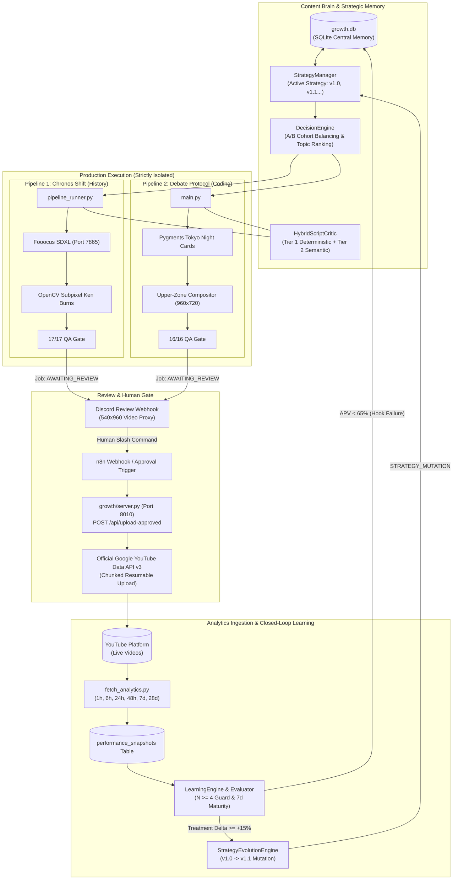

# YouTube Shorts Automation Engine (Dual-Pipeline Growth Intelligence Platform)

A production-grade, closed-loop YouTube Shorts generation, validation, review-gating, and empirical learning platform powering two automated channels:

1. **Pipeline 1: Chronos Shift (`alternate-history-shorts`)**
   - **Niche**: Alternate History & Groundbreaking Historical "What-If" Documentary Shorts.
   - **Visuals**: 100% Full-screen 9:16 cinematic SDXL visuals rendered via local Fooocus with subpixel OpenCV Ken Burns directional focal zoom.
   - **Voice & Audio**: Authoritative documentary narration (`en-US-ChristopherNeural`, Edge-TTS) with cinematic orchestral background music.
   - **Subtitles**: Dynamic karaoke-style word-highlight ASS subtitles.

2. **Pipeline 2: Debate Protocol / Senior Dev (`convo-shorts`)**
   - **Niche**: Software Engineering, Architecture, and Technical Deep Dives.
   - **Visuals**: Full-screen kinetic gameplay background (Minecraft/Subway Surfers) overlaid with 960x720 floating dark-mode code cards (Tokyo Night syntax rendered via Pygments + Consolas vector graphics).
   - **Voice & Audio**: Senior Technical Narrator (`en_US-ryan-medium.onnx` / Piper TTS) with multi-angle concept generation.
   - **Subtitles**: Speaker-differentiated highlighted captions (Yellow for Speaker A, Cyan for Speaker B).

---

## 🏛️ High-Level System Architecture



---

## 🗄️ Core Database Schema (`growth/growth.db`)

All pipeline runs, metadata, experiment arms, and performance logs are natively persisted in SQLite:

| Table | Purpose |
|---|---|
| `channels` | Channel definitions, default strategies, target upload schedules (`channel_a`, `channel_b`). |
| `jobs` | Production job lifecycle states (`GENERATING`, `AWAITING_REVIEW`, `UPLOADING`, `PUBLISHED`, `QA_FAILED`). |
| `videos` | Master registry of rendered videos, metadata (title, description), duration, and YouTube video IDs. |
| `experiments` | A/B testing definitions, hypotheses, variable tested, and minimum sample size ($N \ge 4$). |
| `experiment_arms` | Specific control vs treatment variant configurations and live sample counts. |
| `performance_snapshots` | Empirical performance records across standard evaluation windows (`1h`, `6h`, `24h`, `48h`, `7d`, `28d`). |
| `learning_events` | Audit trail of Content Brain discoveries, `HOOK_FAILURE` logs, and `STRATEGY_MUTATION` events. |
| `strategy_versions` | Immutable versions of channel strategy profiles (`v1.0`, `v1.1`, etc.). |

---

## 🛠️ Operations Manual

### 1. Launching Background Services
Before generating videos, start Ollama, Fooocus SDXL, and verify CUDA acceleration:
```bat
start_services.bat
```
To launch the Growth REST API Server (Port 8010):
```powershell
$env:PYTHONIOENCODING="utf-8"; python growth/server.py
```

### 2. Executing Generation Pipelines

#### Pipeline 1 (Chronos Shift - History Shorts)
```powershell
$env:PYTHONIOENCODING="utf-8"; python alternate-history-shorts/scripts/pipeline_runner.py --topic "What If the Library of Alexandria Survived?"
```

#### Pipeline 2 (Debate Protocol - Technical Coding Shorts)
```powershell
$env:PYTHONIOENCODING="utf-8"; python convo-shorts/yt-automation-engine/main.py --topic "Postgres vs Redis for Session Caching" --category "Coding"
```

### 3. Human Approval & YouTube Upload Trigger
When a video completes QA, a `540x960` proxy is posted to Discord for human review. To approve and publish:

#### Via n8n / REST API:
```bash
curl -X POST http://127.0.0.1:8010/api/upload-approved \
     -H "Content-Type: application/json" \
     -d '{"job_id": "YOUR_JOB_ID", "privacy_status": "public"}'
```

### 4. Running Analytics Ingestion & Learning Engine

#### Run Ingestion for Due Snapshot Windows:
```powershell
# Live YouTube Analytics API query:
$env:PYTHONIOENCODING="utf-8"; python growth/analytics/fetch_analytics.py

# Simulation Dry-Run:
$env:PYTHONIOENCODING="utf-8"; python growth/analytics/fetch_analytics.py --dry-run
```

#### Run Content Brain Learning Cycle & Hook Audit:
```powershell
$env:PYTHONIOENCODING="utf-8"; python -c "from growth.brain.learning_engine import LearningEngine; from growth.db.models import GrowthRepository; repo = GrowthRepository(); engine = LearningEngine(repo); print(engine.run_channel_learning_cycle('channel_a'))"
```

#### Run Full Test Suite:
```powershell
$env:PYTHONIOENCODING="utf-8"; python -m unittest discover -s growth/tests -p "test_*.py"
```

---

## 🔒 Strict Production Invariants

1. **Dual-Pipeline Isolation**: Neither pipeline shall ever import, call, or share video assembly wrappers from the other.
2. **Fooocus SDXL Invariant**: All image generation uses local Fooocus on `http://127.0.0.1:7865`. Zero external cloud image APIs.
3. **Human Gate Requirement**: Videos are never uploaded automatically without explicit human Discord approval.
4. **Empirical Evidence Dominance**: Strategy promotions require mature 7-day performance data with $N \ge 4$ samples per arm and $\Delta \ge +15.0\%$ APV.