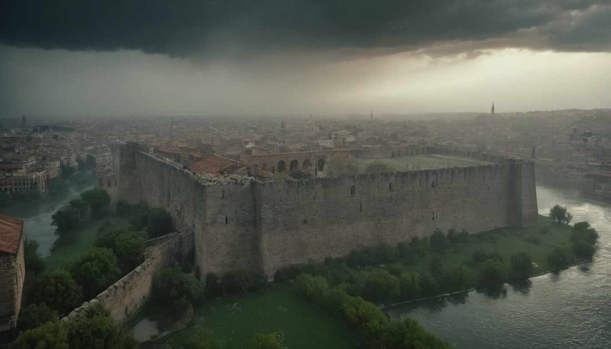
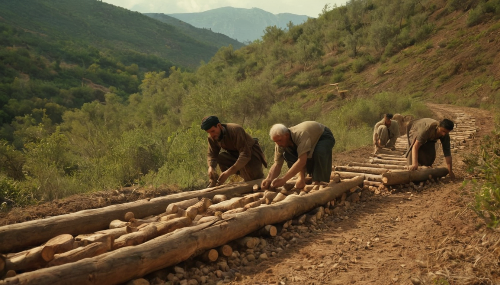

# Week 1 Flagship Production: The 53 Days That Shattered Rome (1453)

> **Channel:** Chronos Shift (`@sainishath4220`)  
> **Release ID:** `week_01_constantinople_1453`  
> **Production Date:** October 30, 2026  
> **Master Runtime:** 9 minutes 07 seconds (547.3s) across 80 high-density visual shots  
> **Format:** 16:9 Widescreen 1080p Master + 5x 9:16 Vertical Shorts (1080x1920)

---

## 1. Visual Showcase & High-Fidelity Keyframes

All 80 visual shots were synthesized strictly on local GPU hardware via Fooocus SDXL (`http://127.0.0.1:7865`, `juggernautXL_v8Rundiffusion.safetensors`, 1344x768 resolution) adhering strictly to **Rule 2 (Zero Cloud Image APIs)**.

| Act 1: The Theodosian Walls | Act 3: Urban's Basilic Supercannon | Act 4: The 70-Warship Overland Transit |
| :---: | :---: | :---: |
|  |  |  |
| *Triple-walled limestone defenses rising from mist* | *26-foot bronze supercannon firing 1,200 lb granite* | *70 warships hauled over Galata ridge on greased logs* |

---

## 2. Master Documentary Specifications

* **Master File:** `longform_engine/output/history_10min/constantinople_1453_10min_master.mp4`
* **File Size:** 172,594,299 bytes (~172.6 MB)
* **SHA256:** `4747cf56828bd6cd6cf9ada843c430b73a0865cc7f1f68624dd7b249fcfe455d`
* **Video Streams:** H.264 (High Profile, 1920x1080, 25/30 fps, Progressive)
* **Audio Streams:** AAC 192 kbps stereo (`en-US-ChristopherNeural` voiceover + 7% ambient orchestral score)
* **Audio Ducking:** FFmpeg `sidechaincompress` (`threshold=0.08`, `ratio=6.0`, `release=250ms`)
* **Interactive Elements:**
  * Animated Act Progress Badges burned in upper right `(X=1520, Y=60)` with 0.5s fade-in/fade-out
  * Transparent aged parchment primary source manuscript quote cards
  * Procedural tactical siege map with animated assault vectors
  * Real-time Galata ridge overland fleet transit animation with HUD elevation profile

---

## 3. Chapter Breakdown & Primary Source Evidence

| Act | Timestamp | Title | Eyewitness Primary Source Record |
| :---: | :---: | :--- | :--- |
| **I** | `00:00` | The Setting: The Theodosian Walls and a Dying Empire | Imperial Chancellor George Sphrantzes, Census Record (1453) |
| **II** | `01:18` | The Challenger: Sultan Mehmed II's Ambition | Kritovoulos of Imbros, *Life of Mehmed the Conqueror* |
| **III** | `02:35` | The Superweapon: Urban the Engineer & The Basilic Cannons | Michael Ducas, *Historia Byzantina* |
| **IV** | `03:53` | The Naval Feat: Hauling Warships Over Land to the Golden Horn | Niccolò Barbaro, Venetian Surgeon's Diary (1453) |
| **V** | `05:09` | The Siege Grinds: Sappers, Counter-Mines, and Greek Fire | George Sphrantzes, *Chronicon Maius* |
| **VI** | `06:28` | The Final Breach: May 29, 1453, & The Imperial Gate | Niccolò Barbaro, Venetian Surgeon's Eye-Witness Account |
| **VII** | `07:53` | The Legacy: Exodus of Scholars & The Renaissance Dawn | Cardinal Isidore of Kiev, Letter to Pope Nicholas V |

---

## 4. Derived Vertical Shorts (9:16 Mobile-Safe)

Each Short is sliced directly around a dramatic turning point from the master video, converted to vertical 9:16 (1080x1920) with subtle focal drift, burned with mobile-safe subtitles (`MarginV=620` avoiding YouTube UI collisions), and provided with conversion-funnel pinned comments.

| Short ID | Output File | Duration | Title & Hook | Primary Source |
| :---: | :--- | :---: | :--- | :--- |
| **01** | `shorts/short_01_0s.mp4` | 45.0s | **4,983 Men vs 100,000: The Secret Defense of Constantinople** *"Only 4,983 citizens volunteered to defend four miles of limestone walls."* | George Sphrantzes |
| **02** | `shorts/short_02_86s.mp4` | 45.0s | **The 21-Year-Old Sultan Who Built a Fortress in 4 Months** *"Mehmed II threw up Rumelihisarı in 120 days to choke the Bosporus."* | Kritovoulos of Imbros |
| **03** | `shorts/short_03_172s.mp4` | 45.0s | **Urban's 27-Foot Bronze Cannon That Ended Medieval Warfare** *"Urban's monster hurled 1,200-pound granite balls across the Bosporus."* | Michael Ducas |
| **04** | `shorts/short_04_258s.mp4` | 45.0s | **How the Ottomans Hauled 70 Warships Across Mountains Overnight** *"In a single night, 70 warships rolled across the Galata ridge on greased logs."* | Niccolò Barbaro |
| **05** | `shorts/short_05_344s.mp4` | 45.0s | **Subterranean Hell: Counter-Mining and Greek Fire Beneath the Walls** *"Johannes Grant burned Ottoman miners alive in suffocating underground shafts."* | George Sphrantzes |

---

## 5. Artifact & Manifest File Index

* [`production_manifest.json`](./production_manifest.json): Machine-readable production metadata, hashes, and runtimes.
* [`youtube_description.txt`](./youtube_description.txt): Full upload-ready YouTube title, description, chapter timestamps, and tags.
* [`chapters.ffmetadata`](./chapters.ffmetadata): Standard FFMPEG chapter definition file.
* [`history_10min_80shots.json`](./history_10min_80shots.json): Complete 80-shot narrative and prompt specification.
* [`shorts/`](./shorts/):
  * `short_01_metadata.json` through `short_05_metadata.json`
  * `short_01_subtitles.ass` through `short_05_subtitles.ass`
